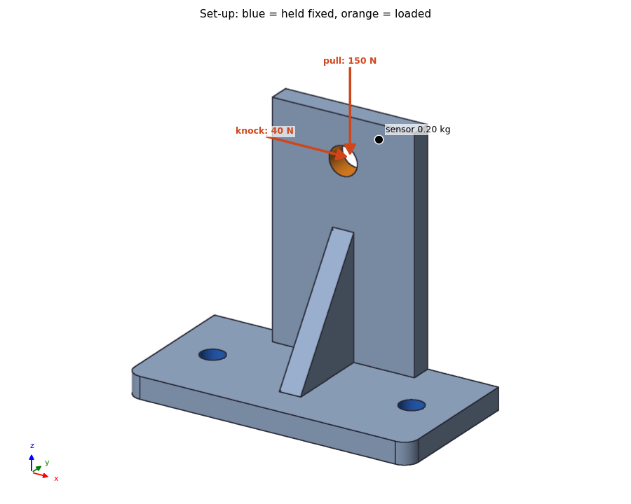
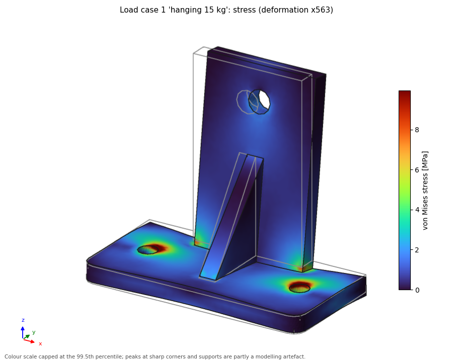
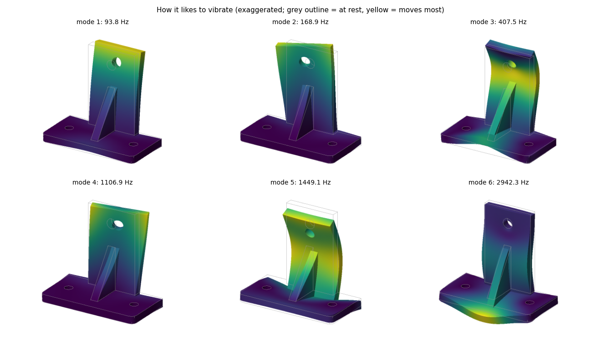
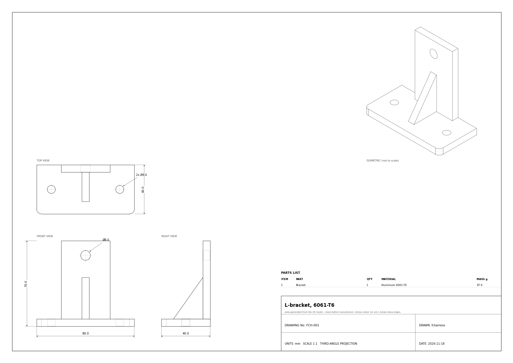

# freecad-harness

**A mechanical-engineering sidekick for people who are not mechanical engineers.**

You have a CAD model — a bracket, a mount, a printed enclosure, a small assembly — and you need to
know: *Will it break? Will it bend too much? Will it shake itself apart next to that motor? Can
someone make it from this drawing?* `fcharness` drives [FreeCAD](https://www.freecad.org) headless
to answer those questions and explains the answers in plain language, **with pictures**.

| What you describe | What you get back |
|---|---|
|  |  |
| "Bolted down by the two holes, a 15 kg pull on the top hole, a 0.2 kg sensor on a pin." | A traffic-light verdict, where it is stressed, how much margin there is and what to change. |

Same bracket, two materials — the kind of trade-off the harness is meant to surface:

| | machined 6061 aluminium | 3D-printed PLA |
|---|---|---|
| strength (safety factor) | 🟢 34 | 🟢 3.1 |
| lowest vibration mode | 🟢 406 Hz | 🔴 94 Hz — inside the 50–120 Hz motor band |
| report | [bracket](docs/examples/bracket/report.md) | [bracket_pla](docs/examples/bracket_pla/report.md) |



Each run also produces an A3 drawing (PDF/SVG) with views, overall dimensions, hole callouts, a parts
list and a title block:



## What it does today (v0.1)

- **Loads** FCStd, STEP/IGES, BREP or STL; finds the parts and their subassemblies.
- **Materials** library with typical values: 6061-T6, 5052-H32, mild steel, 304 stainless, and FDM-printed
  PLA / PETG / PET-CF / ABS with separate in-layer and across-layer strengths. Custom materials in the job file.
- **Describe the set-up in plain geometry** — no "Face17": `{cylinders: {diameter: 6.6}}` (all M6 clearance holes),
  `{plane: {normal: [0,0,-1]}}` (the underside), `{near_point: [x,y,z]}`.
- **Several load cases** in one run, gravity in any direction, **point masses** (a sensor, a battery) hung
  on their mounting faces, **reaction forces** at each support.
- **Strict, checkpointed pipeline**: load → materials → setup → validate → mass → mesh → solve → review →
  drawing → report. Every step writes `checkpoints/NN_<step>.json`; the validator refuses jobs that
  would give meaningless answers (unknown keys, nothing holding the part, selectors that match nothing,
  mesh coarser than the wall, loads only on fixed faces) and explains how to fix them.
- **Self-checks on the answers**: reactions must balance the applied loads (<1 %), and the solver must
  see all of the model's mass (this caught a CalculiX quirk that silently dropped point masses).
- **Solvers**: CalculiX static (multi-case) and modal, on gmsh second-order tetrahedra.
- **Mass, centre of gravity, inertia** per part and total, including point masses.
- **Pictures, headless**: a small numpy z-buffer renderer (no GPU, no GUI) for set-up views, stress and
  displacement contours on the deformed shape, and mode shapes.
- **Drawings**: TechDraw hidden-line projection → third- or first-angle A3 sheet as PDF/SVG/PNG, plus an
  editable TechDraw page in the saved FCStd.
- **Report** in Markdown and HTML: verdict first, then each check with a picture, a number, what it
  means and what to change, then assumptions.

## Quick start

Requires FreeCAD ≥ 1.0 (tested on 1.1.4; its bundled Python, numpy, matplotlib, gmsh and CalculiX are
all that is needed).

```sh
# build the example model (or bring your own STEP/FCStd)
freecadcmd examples/bracket/make_bracket.py
# run a job; FreeCADCmd treats extra arguments as files to open, so the job goes in an env variable
FCH_JOB=examples/bracket/job.yaml freecadcmd run.py
# -> examples/bracket/out/bracket/report.html, drawing.pdf, img/*.png, checkpoints/*.json
```

A job file is short and readable — see [examples/bracket/job.yaml](examples/bracket/job.yaml) and the
reference at the top of [fcharness/job.py](fcharness/job.py).

## Is it right? Benchmarks

`freecadcmd tests/fc_benchmarks.py` runs analytical cases through the *whole* pipeline:

| case | harness | theory | error |
|---|---|---|---|
| cantilever 200×20×4 steel, 10 N tip load: tip deflection | 1.1803 mm | 1.1905 mm | −0.9 % |
| same beam under 100 g self-weight | 5.439 µm | 5.501 µm | −1.1 % |
| 100×10×10 steel bar, first bending frequency | 833.4 Hz | 835.5 Hz | −0.3 % |
| same bar with a 0.5 kg tip mass | 160.16 Hz | 160.15 Hz | +0.0 % |

Pure-Python unit tests (job validation, materials, verdicts): `python3 tests/test_job.py`.

## Honest limitations (v0.1)

- Linear-elastic only; no contact, bolt preload, plasticity or fatigue life yet. Touching parts are bonded.
- Supports are fixed (all translations). Pinned/sliding supports and bearings-as-joints are on the roadmap.
- Linear buckling, interference/printability/drawing-consistency checks, CAM export and multi-part
  energy breakdown are planned — see [docs/roadmap.md](docs/roadmap.md).
- Material values are typical published figures, not certified allowables. This is a first engineering
  look to support decisions, **not** a substitute for a qualified engineer on safety-critical parts.

## Credits

The checkpointed workflow (analysis → material → sections → supports/loads → mesh → strict validation →
solve → results review), the safety posture (fixed, typed operations; no arbitrary code) and the
analytical benchmark cases are adapted from **[freecad-fem-mcp](https://github.com/ymiya55/freecad-fem-mcp)**
by ymiya55 (MIT). Built on FreeCAD, gmsh and CalculiX.

## License

MIT © 2026 Divya Tiwari — see [LICENSE](LICENSE).
