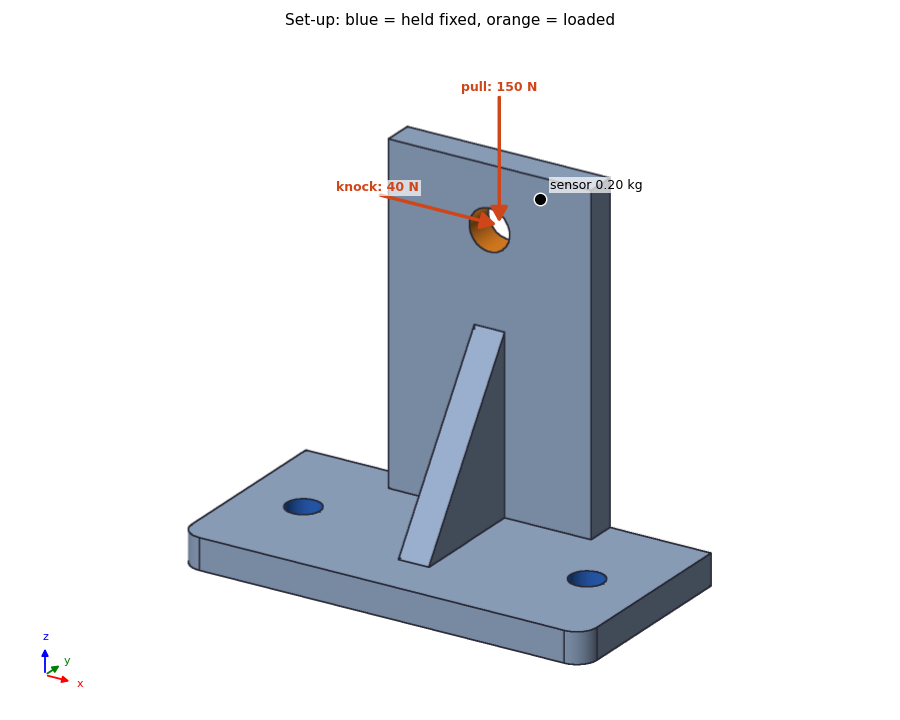
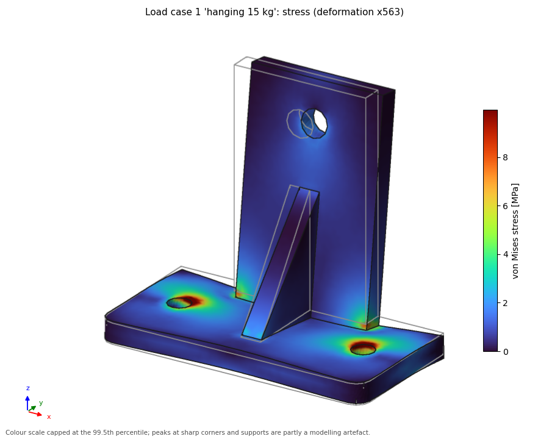
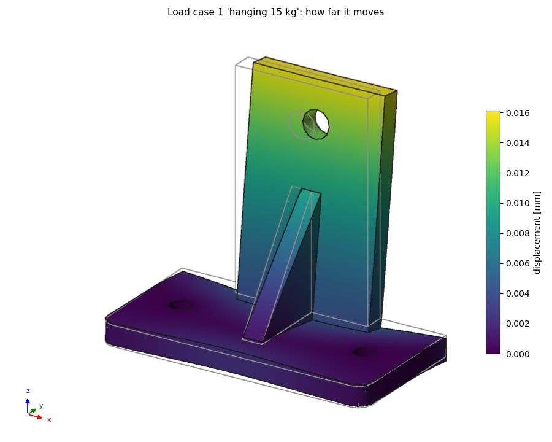
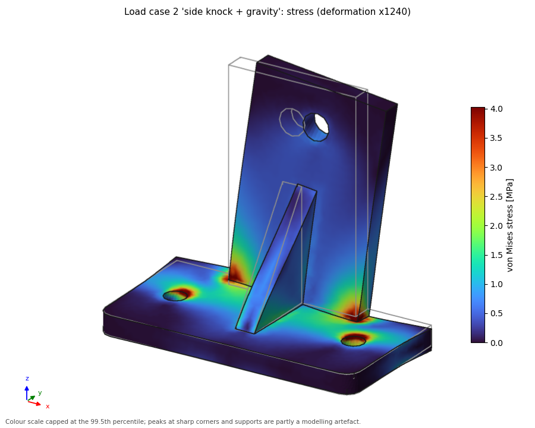
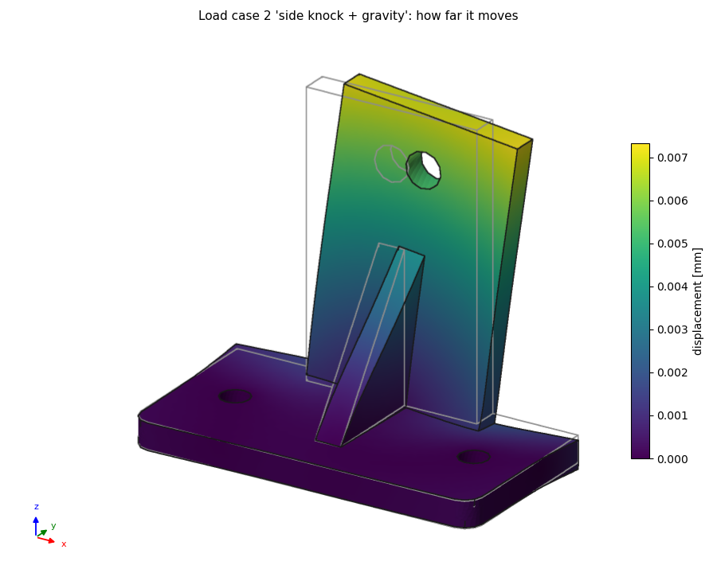
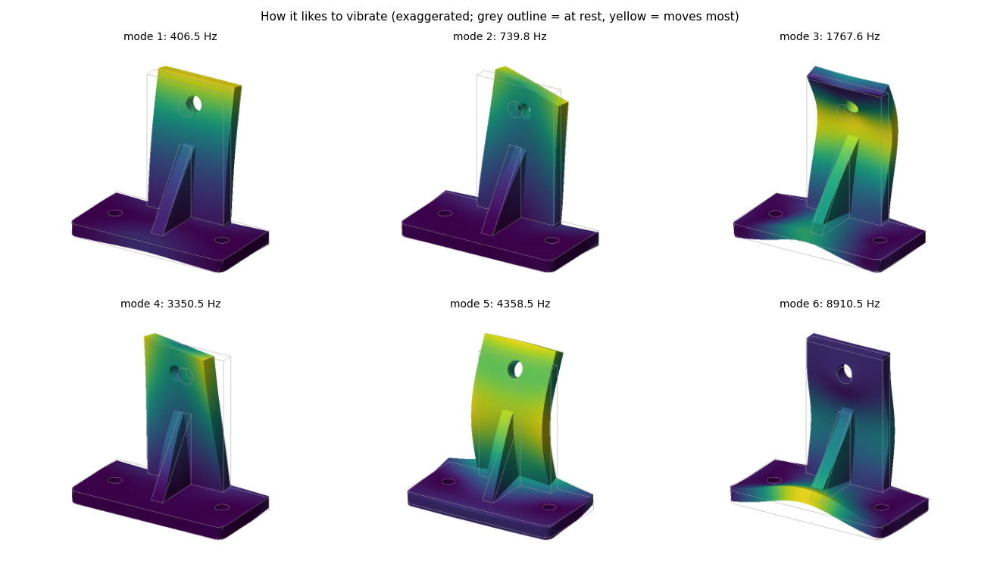
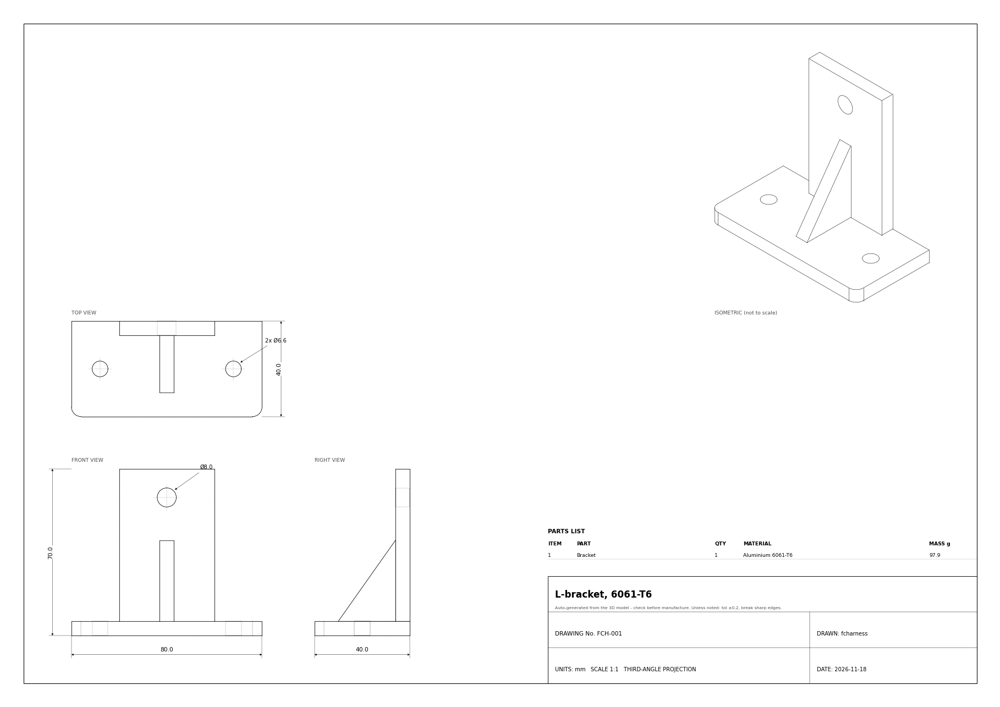

# Design review: bracket

This report was generated automatically by **fcharness** from `bracket.step`. It is a first engineering look meant to help you decide - not a certification. Every number comes from a computer model with the assumptions listed at the end.

## Verdict

> 🟢 **Looks fine** — worst of the checks below (5 checked).

## 1. What was analysed



*The model as the harness sees it. Blue faces are held fixed; orange faces carry the loads (arrows).*

| part | subassembly | material | mass (g) | size x×y×z (mm) |
|---|---|---|---|---|
| Bracket | - | Aluminium 6061-T6 | 97.9 | 80×40×70 |
| sensor | (point mass) | - | 200.0 | - |

**Total mass 297.9 g**, centre of gravity at (40.0, 42.6, 45.0) mm.

- **Held:** bolt holes - `{"cylinders": {"diameter": 6.6}}`

- **Load case 'hanging 15 kg':** pull: 150 N towards (0.00, 0.00, -1.00)

- **Load case 'side knock + gravity':** knock: 40 N towards (1.00, 0.00, 0.00); gravity (0, 0, -1) g

- **Carried mass:** sensor, 0.20 kg at (40.0, 50.0, 58.0) mm

## 2.1 Strength and stiffness - load case 'hanging 15 kg'



*Where the material works hardest (red). The shape is exaggerated so you can see how it bends.*

> 🟢 **Bracket: safety factor 34.5** — Strong enough: it could take about 34.5x this load before the material gives way.

| part | highest stress (MPa) | peak incl. support edges | material can take (MPa) | safety factor | hot-spot at (mm) |
|---|---|---|---|---|---|
| Bracket | 8.0 | 17.7 | 276 | 34.49 | (60, 34, 7) |

> 🟢 **Stiffness** — Stiff: it moves 0.016 mm under load (barely measurable). Largest movement at (40, 40, 70) mm.



*How far each point moves under this load case.*

Check: the supports push back with (0.0, 0.0, 150.0) N, balancing the applied (0.0, 0.0, -150.0) N (error 0.00%). Per support: bolt holes (0.0, 0.0, 150.0) N.

## 2.2 Strength and stiffness - load case 'side knock + gravity'



*Where the material works hardest (red). The shape is exaggerated so you can see how it bends.*

> 🟢 **Bracket: safety factor 38.4** — Strong enough: it could take about 38.4x this load before the material gives way.

| part | highest stress (MPa) | peak incl. support edges | material can take (MPa) | safety factor | hot-spot at (mm) |
|---|---|---|---|---|---|
| Bracket | 7.2 | 7.2 | 276 | 38.42 | (59, 34, 7) |

> 🟢 **Stiffness** — Stiff: it moves 0.007 mm under load (barely measurable). Largest movement at (60, 34, 70) mm.



*How far each point moves under this load case.*

Check: the supports push back with (-40.0, 0.0, 2.9) N, balancing the applied (40.0, 0.0, -2.9) N (error 0.00%). Per support: bolt holes (-40.0, 0.0, 2.9) N.

## 3. Vibration



*The first natural vibration shapes. If something shakes the part near one of these frequencies, it can resonate.*

> 🟢 **Lowest natural frequency 406 Hz** — Lowest vibration mode 406 Hz is safely above the 50-120 Hz excitation band.

| mode | frequency (Hz) | main motion | which part flexes (strain energy) |
|---|---|---|---|
| 1 | 406.5 | front-to-back (y) | - |
| 2 | 739.8 | side-to-side (x) | - |
| 3 | 1767.6 | up-and-down (z) | - |
| 4 | 3350.5 | side-to-side (x) | - |
| 5 | 4358.5 | up-and-down (z) | - |
| 6 | 8910.5 | up-and-down (z) | - |

**What to change:** to raise a frequency, make the part stiffer in the direction it moves in that mode (ribs, thicker walls, shorter overhangs) or make the carried mass lighter / closer to the supports.

## 4. Drawing



*Auto-generated drawing sheet (third-angle, scale 1:1). Full-resolution: drawing.pdf / drawing.svg.*

[drawing.pdf](drawing.pdf) · [drawing.svg](drawing.svg) · the saved `model_with_analysis.FCStd` also contains an editable TechDraw page.

## 5. Assumptions and warnings

- Linear-elastic model: valid while nothing yields, buckles or slips. Supports are perfectly rigid (real ones flex a bit, which lowers frequencies slightly).
- Touching parts are treated as glued together; bolt preload, friction and gaps are not modelled.
- Printed plastics use the weaker across-layer (z) strength everywhere - conservative.
- Stress right at the edge of a fixed face or at a sharp inside corner is not reliable; the safety factor uses the highest stress at least one element away from supports (the peak is shown for reference).
- Mesh: 20089 nodes, 10855 quadratic tetrahedra, target size 3 mm. Halve size_mm and re-run to confirm results change by only a few %.

## 6. Reproduce

Run `FCH_JOB=examples/bracket/job.yaml fc run.py` from the repository. Every step's inputs/outputs are in `checkpoints/`; solver decks and logs in `work/`.

```
# Example job: an aluminium L-bracket bolted down with two M6 bolts, carrying a 0.2 kg sensor on a
# pin through the d8 hole. Read top to bottom - every line is plain geometry, no face numbers.
name: bracket
model: bracket.step
default_material: al_6061_t6

supports:
  - name: bolt holes
    type: fixed
    where: {cylinders: {diameter: 6.6}}      # both M6 clearance holes

point_masses:
  - name: sensor
    mass_kg: 0.2
    at: [40, 50, 58]                         # its centre of gravity, 10 mm behind the upright
    attach: {cylinders: {diameter: 8}}       # hangs on a pin in the d8 hole

load_cases:
  - name: hanging 15 kg
    forces:
      - name: pull
        where: {cylinders: {diameter: 8}}
        force_N: [0, 0, -150]
  - name: side knock + gravity
    gravity_g: [0, 0, -1]
    forces:
      - name: knock
        where: {cylinders: {diameter: 8}}
        force_N: [40, 0, 0]

analyses: [static, modal]
modal: {modes: 6, avoid_hz: [50, 120]}       # e.g. a motor running 3000-7200 rpm nearby
mesh: {size_mm: 3.0}
checks: {safety_factor_target: 2.0, safety_factor_min: 1.5}
drawing: {projection: third_angle, title: "L-bracket, 6061-T6"}
```
